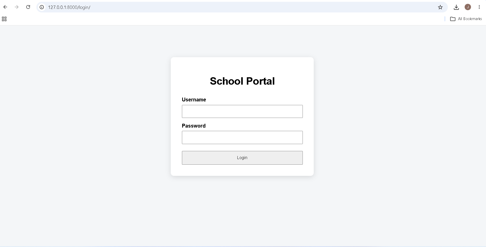
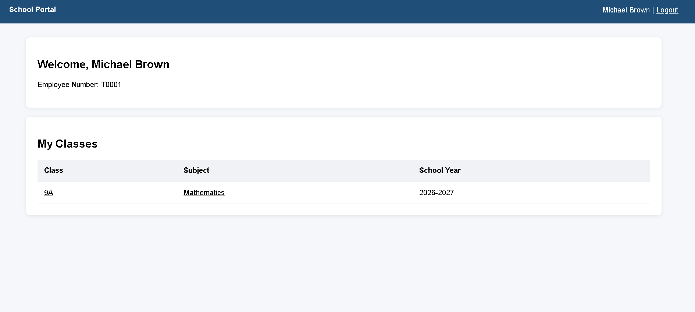
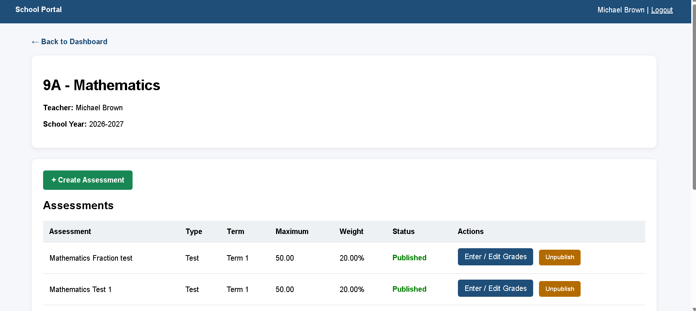
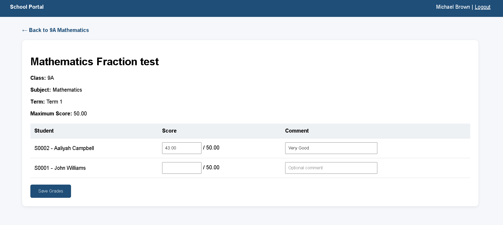
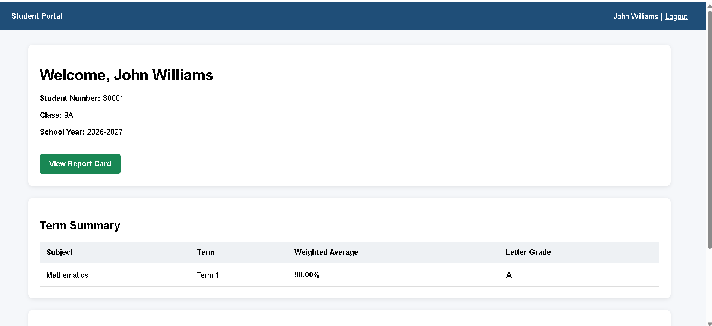
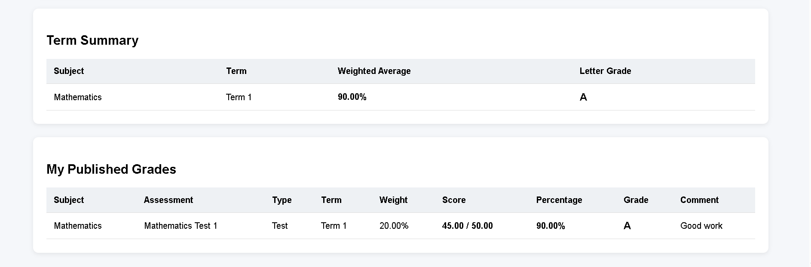
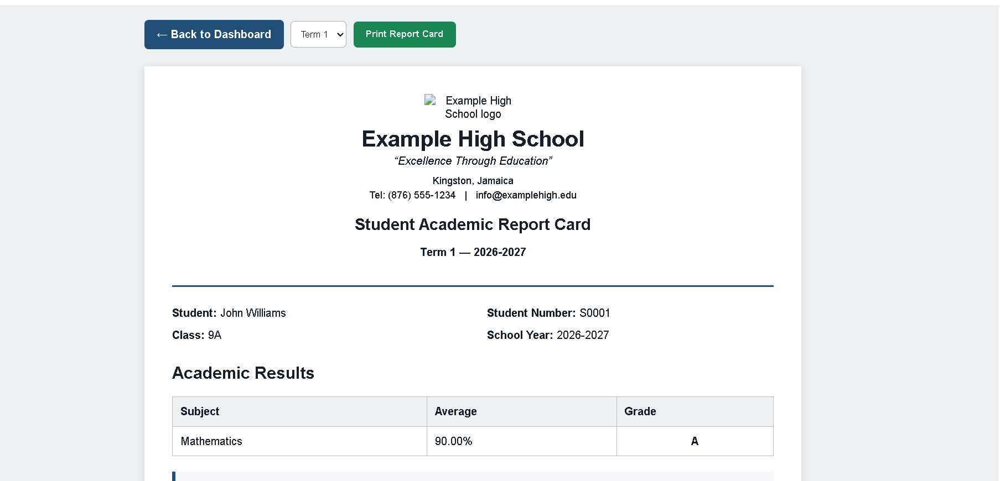
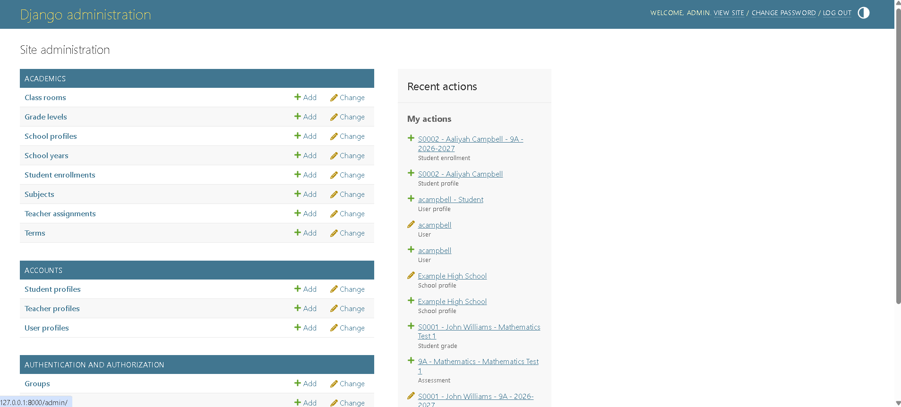

# Student Academic Management Portal

A role-based academic management web application built with **Python, Django, PostgreSQL, HTML, CSS and JavaScript**. The project demonstrates custom web application development for school workflows such as student enrollment, class/subject assignment, assessments, grade publishing, attendance and printable academic reporting.

## Features

- Administrator management through Django Admin
- Teacher and student role-based authentication
- School years, terms, grade levels, classrooms and subjects
- Student enrollment and teacher/class/subject assignments
- Teacher assessment creation and grade entry/editing
- Publish/unpublish controls for student-visible results
- Weighted subject averages and letter-grade calculation
- Student dashboard with published grades
- Term-specific printable report cards
- School profile, logo, contact information and branding
- Attendance, form-teacher comments and principal comments
- PostgreSQL persistence through Django ORM
- Environment-variable configuration for secrets

## Application Screenshots

### Portal Login
Teachers and students use a secure login page to access their respective dashboards.

### Teacher Dashboard
Teachers can view their assigned classes, subjects, and academic year.

### Class & Assessment Management
Teachers can create assessments, manage existing assessments, enter grades, and publish or unpublish results.

### Grade Entry
Teachers can enter and edit student scores and provide feedback before publishing results.

### Student Dashboard
Students can view their academic information, term summary, averages, and available report cards.

### Published Grades
Students can review published assessment results, percentages, grades, and teacher comments.

### Academic Report Card
The portal generates a structured report card containing academic performance, attendance, comments, and school information.

### Administration Dashboard
Administrators can manage users, teachers, students, school years, terms, classes, subjects, enrollments, assignments, assessments, grades, and school information.

## Technology

- Python
- Django
- PostgreSQL / Django ORM
- HTML5, CSS3, JavaScript
- Git / GitHub

## Local Setup

1. Clone the repository and enter the project directory.
2. Create a virtual environment: `python -m venv venv`
3. Activate it on Windows PowerShell: `.\\venv\\Scripts\\Activate.ps1`
4. Install dependencies: `pip install -r requirements.txt`
5. Copy `.env.example` to `.env` and set your PostgreSQL credentials.
6. Create the PostgreSQL database named in `.env`.
7. Run `python manage.py migrate`.
8. Create an administrator with `python manage.py createsuperuser`.
9. Start the server with `python manage.py runserver`.
10. Visit `http://127.0.0.1:8000/login/` for the portal or `/admin/` for administration.

## Security Notes

The repository excludes local environment files, database credentials, virtual environments, compiled Python files and local database files. Use a unique `DJANGO_SECRET_KEY` and `DEBUG=False` for deployment.

## Portfolio Relevance

This project demonstrates requirements-driven development of a custom academic web application, relational data modelling, ORM usage, authentication/authorization, CRUD workflows, validation, reporting, debugging and maintainable Django project structure.

## Documentation

Complete user documentation is included with the project.

### Administrator Setup Manual

A visual step-by-step guide for administrators covering school setup, teacher accounts, student accounts, classes, subjects, enrollments, teacher assignments, and system testing.

[View Administrator Setup Manual](docs/Student_Academic_Portal_Admin_Setup_Manual.pdf)

### Teacher & Student User Manual

A visual step-by-step guide showing teachers how to manage assessments and grades, and students how to view published results and print report cards.

[View Teacher & Student User Manual](docs/Student_Academic_Portal_Visual_User_Manual_v2.pdf)